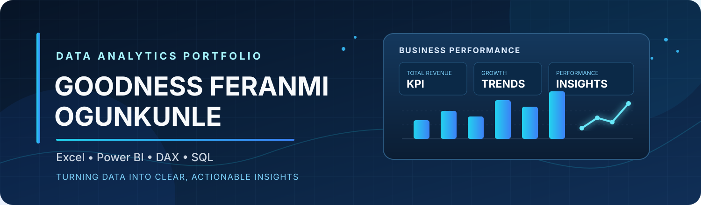

# Goodness Feranmi Ogunkunle

### Data Analyst | Business Intelligence | Data Visualization

*Turning raw data into clear insights and practical business decisions.*

---

## 👋 About Me

I am a developing **Data Analyst** with a B.Tech background in **Animal Production and Health** and a growing focus on data analytics, business intelligence, and reporting.

I enjoy transforming raw information into useful insights—cleaning and organizing datasets, exploring business performance, building dashboards, and communicating findings in a clear and practical way.

- 📍 **Location:** Ibadan, Oyo State, Nigeria
- 🎯 **Career interests:** Data Analysis, Business Intelligence, Reporting, and Dashboard Development
- 📚 **Current focus:** Strengthening Power BI, DAX, SQL, and analytical storytelling

## 🧰 Technical Skills & Tools

| Competency | Tools / Techniques |
|---|---|
| Spreadsheet analysis | Excel formulas, PivotTables, PivotCharts |
| Business intelligence | Power BI reports, KPI dashboards |
| Data modelling & calculations | Power Pivot, DAX measures, calculated columns |
| Data preparation | Data cleaning, transformation, validation |
| Data querying | SQL fundamentals |
| Communication | Data visualization, reporting, insight presentation |

## 📊 Featured Projects

### 1. Retail Business Performance Dashboard

**Tools:** Microsoft Excel · Power Pivot · DAX · PivotTables · PivotCharts

An interactive Excel dashboard built to monitor retail performance and explore sales results across business dimensions.

**Key analysis areas**
- Total sales, profit, profit margin, and target achievement
- Monthly sales trends and regional performance
- Product category and sales channel comparisons
- Sales representative performance and product returns
- Interactive slicers for year, region, category, and channel

---

### 2. Excel Sales Tracking Analysis

**Tools:** Microsoft Excel · PivotTables · Charts

A sales analysis project exploring transaction performance, revenue, profit, product categories, regional results, monthly trends, and quantity sold.

---

### 3. More Projects in Progress

I am developing additional Power BI and SQL case studies. New projects will be published as they are completed, with their business questions, data preparation steps, analysis, visualizations, and findings.

## 🔎 My Analytical Workflow

| Stage | What I do |
|---|---|
| **01 · Define** | Understand the business question and expected outcome |
| **02 · Prepare** | Clean, organize, and validate the data |
| **03 · Analyze** | Explore patterns, trends, and performance |
| **04 · Visualize** | Present insights through KPIs, charts, and dashboards |
| **05 · Communicate** | Explain findings and identify practical next steps |

## 🌱 Current Learning Goals

- Improve Power BI data modelling, DAX, and report design
- Build confidence with SQL querying and data analysis
- Develop stronger data storytelling and business communication
- Create portfolio projects based on realistic business questions

## 🤝 Let's Connect

I welcome opportunities to learn, collaborate, and contribute to data-focused projects. I am interested in **entry-level Data Analyst opportunities, internships, freelance projects, and professional collaborations**.

- 💼 **LinkedIn:** [Connect with me](https://www.linkedin.com/in/ogunkunle-goodness-b47186412)
- 🧑‍💻 **GitHub:** [@Godspeedxreal](https://github.com/Godspeedxreal)

---

**Thanks for visiting my portfolio.**

*Curious about data · Focused on insight · Committed to continuous growth*

